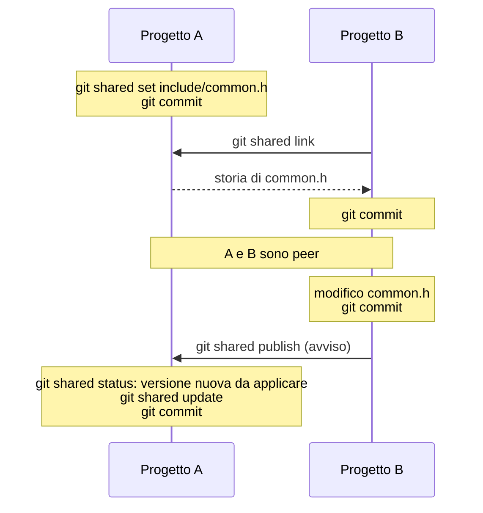
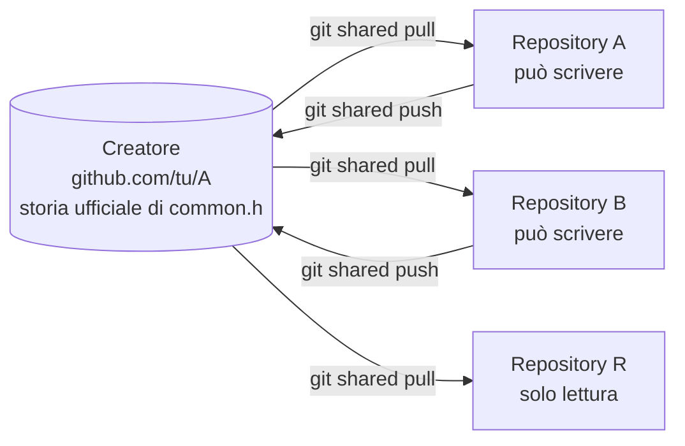
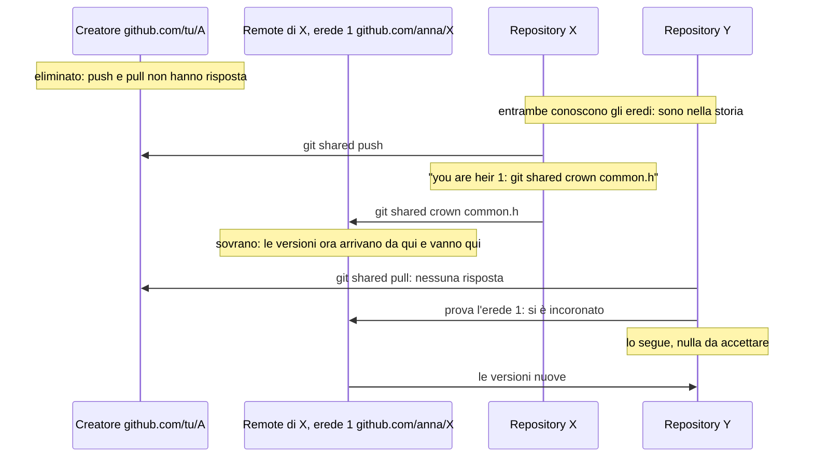
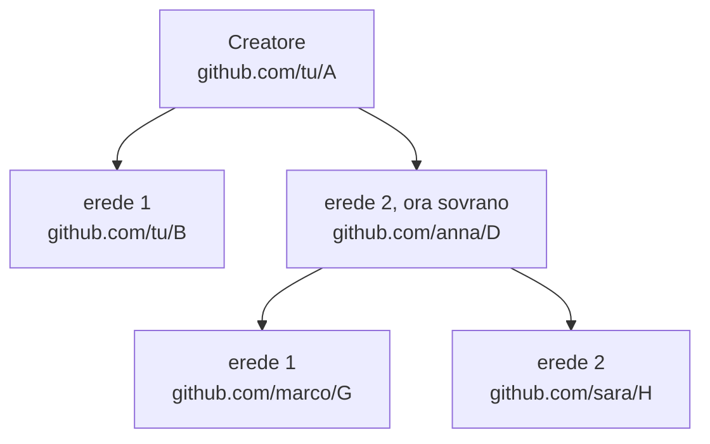

🇮🇹 [Leggi in italiano](README.it.md)
🇬🇧 [Read in English](README.md)

# Shared Files for Git

Un **file condiviso** in più repository Git™, sempre allineato.

Un header comune, un file di configurazione, uno script: spesso servono a più progetti, e copiarli a mano porta prima o poi a copie diverse. `git shared` è un'estensione di git che tiene **lo stesso file allineato in più repository**. Modifichi il file in un progetto qualsiasi e lo pubblichi; gli altri progetti vengono a sapere che c'è una versione nuova e la adottano quando vogliono, con un comando.

Il file resta un file normale: chi usa la repo senza l'estensione lo vede, lo compila e lo usa come sempre.

> **Stato:** prima versione, tra repository sulla **stessa macchina**. L'uso tra repository remote (GitHub, GitLab) è in **beta**: vedi [Repository remote](#repository-remote-beta).

## Installazione

**Windows, senza compilare.** Scarica [`dist/windows/git-shared.exe`](dist/windows/git-shared.exe) (compilato dall'ultimo tag, v0.10.0) e mettilo in una cartella del `PATH`, per esempio `%USERPROFILE%\bin`. Serve solo git 2.34 o più recente. Verifica con `git shared -h`; il manuale è in `git shared help`. Il file non è firmato: la prima volta Windows potrebbe chiedere conferma.

**Dai sorgenti.** Servono git 2.34 o più recente, `make` e `gcc` (su Windows MinGW-w64).

```bash
make            # compila
make install    # copia git-shared in ~/bin (Windows: %USERPROFILE%\bin)
git shared -h   # verifica
```

Se `git shared` non viene trovato, aggiungi quella cartella al `PATH`. Su Windows, per avere anche `git shared --help`, lancia `make install` da amministratore.

## In due minuti

```bash
# Progetto A: dichiaro shared l'header
cd ~/progetti/A
git shared set include/common.h
git commit -m "common.h diventa shared"

# Progetto B: lo collego (il path può essere diverso)
cd ~/progetti/B
git shared link ~/progetti/A/include/common.h inc/common.h
git commit -m "collego common.h"      # da qui A e B si conoscono

# In B modifico l'header e pubblico
git commit -am "aggiungo MAX_LEN"
git shared publish                    # A riceve un avviso

# In A adotto la versione nuova
cd ~/progetti/A
git shared status                     # common.h: versione nuova da applicare
git shared update
git commit -m "aggiorno common.h"
```



## Come funziona

- **Nessuna repo principale.** Tutte le repo che usano il file (i *peer*) sono alla pari, e tutte possono modificarlo. Non c'è un server: le repo si parlano direttamente.
- **`.gitshared`.** Elenca i file shared della repo. Lo gestisce l'estensione e si versiona con la repo, come `.gitmodules`.
- **Una storia per file.** Ogni file shared ha una sua piccola storia di versioni, uguale in tutti i peer e separata da quella del progetto. Serve a capire quale versione è più recente.
- **Pubblicare, ricevere, applicare.** `publish` crea una versione e avvisa i peer. Ogni peer la riceve da sé al suo primo comando `git shared`, senza toccare i tuoi file. `update` la porta nel progetto, e tu confermi con un commit.

## Le regole

1. **Conta solo ciò che è committato.** Una modifica non committata non si pubblica mai. `set`, `link`, `unlink` e `mv` diventano effettivi al commit: prima puoi annullarli con `git restore`.
2. **Decidi tu quando.** Si pubblica solo con `git shared publish`, e i comandi non fanno commit da soli. Con `-c` o `-m "messaggio"` committano subito, ma solo il file shared e `.gitshared`: il resto dello staging non entra nel commit.
3. **Il tuo lavoro non si perde.** `update` non sovrascrive modifiche non committate, nemmeno quelle in staging. Per forzare serve `-f`.
4. **Nessuna modifica viene scartata.** Se due repo modificano il file ognuna per conto suo, `update` unisce le versioni come `git merge`. In caso di conflitto risolvi i marker, fai `git add` e rilanci `git shared update`, oppure tieni una delle due versioni, intera, con `git shared update --ours` o `--theirs`. Un file binario non si unisce mai: il file resta la tua versione e scegli con `--ours` o `--theirs`. Per rinunciare c'è `git shared update --abort`.
5. **Nessun blocco.** Puoi modificare il file anche se la tua copia è indietro: il file risulta *divergente* e `update` unisce.

## I comandi

| Comando | Cosa fa |
|---|---|
| `git shared set <file>` | Dichiara shared un file della repo |
| `git shared link <file-in-altra-repo> [<dest>]` | Collega un file shared di un'altra repo; una copia che esiste già resta com'è e `update` la allinea |
| `git shared unlink <file>` | Smette di condividere il file, che resta come file normale |
| `git shared mv <file> <dest>` | Rinomina un file shared, solo in questa repo |
| `git shared status [--peers] [--remote]` | Stato di ogni file shared; con `--peers`, anche quello dei peer; con `--remote`, prima chiede ai creatori |
| `git shared publish [<file>]` | Crea una versione nuova e avvisa i peer |
| `git shared update [--all] [<file>]` | Riceve e applica l'ultima versione; `--ours` / `--theirs` tiene una versione, `--abort` rinuncia a un'unione |
| `git shared push [<remote>] [<file>]` | Remoto (beta): invia al creatore le versioni pubblicate; la prima volta `<remote>` diventa il creatore |
| `git shared pull [<file>]` | Remoto (beta): riceve le versioni del creatore, poi `update` |
| `git shared crown [<remote>] <file>` | Remoto (beta): sposta l'autorità del file su un altro remoto (di default il tuo `origin`), il creatore resta; `--restore` torna al creatore, `--accept` / `--reject` decidono un cambio ricevuto |
| `git shared branch <file> [-a\|-rm <branch>]` | Sceglie i branch su cui il file è shared; sugli altri è un file normale |
| `git shared prune [-n]` | Toglie i peer cancellati o che non condividono più il file |
| `git shared relocate [--copy]` | Avvisa i peer che la repo è stata spostata o copiata |
| `git shared lang [en\|it]` | Lingua del manuale |

Ogni comando ha la sua pagina: `git shared <comando> --help`. Le stesse pagine sono nella cartella [`help/`](help/) (in italiano in [`help/it/`](help/it/)).

## Gli stati

| Stato | Significato | Cosa fare |
|---|---|---|
| allineato | Hai l'ultima versione | Niente |
| da applicare | C'è una versione più recente | `git shared update` |
| da committare | Hai applicato con `update`, manca il commit | `git commit` |
| da pubblicare | Hai una modifica che i peer non hanno | `git shared publish` |
| divergente | Tu e un peer avete modificato il file separatamente | `git shared update` |
| unione in corso | `update` ha trovato un conflitto | Correggi, `git add`, `git shared update`; oppure `git shared update --ours` / `--theirs` |
| in attesa di commit | `set`, `link`, `unlink` o `mv` non ancora committato | `git commit` o `git restore` |
| sospeso | Su questo branch il file non è shared | Niente, o `git shared branch` |
| scollegato | La repo dichiara il file ma non conosce i peer (es. un clone) | `git shared link` |
| incoerente | File rinominato senza `git shared mv` o cancellato, o `.gitshared` modificato a mano | `git shared mv`, `git shared unlink` o `git restore .gitshared` |

## Repository remote (beta)

Su GitHub il flusso principale è provato: `push`, `pull` e `status --remote`. Sovrani ed eredi, descritti sotto, sono provati solo tra repository sulla stessa macchina; permessi, credenziali e GitLab non sono ancora provati. C'è nell'eseguibile Windows di `dist/windows/` (v0.10.0) e nei sorgenti.

Non c'è un server apposta: git shared usa il trasporto di git e i permessi dell'hosting. Viaggia solo la storia delle versioni del file, mai il progetto.

### Il creatore

Ogni file ha un **creatore**: la repository remota del suo primo `git shared push`. Il suo URL sta nella storia delle versioni del file, quindi chi ha il file sa da dove arrivano le versioni nuove. Chi può scrivere sul creatore ci invia le versioni; tutti ricevono da lui.



Come in git, la rete si usa solo quando la chiedi: `publish`, `update` e `status` restano locali; `push` invia al creatore, `pull` riceve da lui e applica, `status --remote` controlla se c'è qualcosa di nuovo.

```bash
# Repository A: il suo remote diventa il creatore di common.h
git shared push origin common.h

# Qualsiasi altra repository: collega il file dal creatore, per ID
# (l'ID lo mostra 'git shared status')
git shared link -c https://github.com/tu/A 0f8c3e5a9b2d4c71a6e0d9b8c7f61234 inc/common.h

# Da qui in poi: publish in locale, poi push al creatore
# (se puoi scriverci) e una copia al tuo remote
git shared publish
git shared push

# Ricevi e applica le versioni del creatore
git shared pull -c
```

Chi non può scrivere sul creatore tiene la sua versione come proposta, qui e nella copia sul suo remote. Non c'è ancora: collegare per nome, ricevere una proposta con un comando, le firme.

### Quando il creatore sparisce

Il creatore non cambia mai: è l'identità del file. Può capitare però che la sua repository venga cancellata, o che tu non riesca più a raggiungerla. Non si perde nulla, perché ogni repository che usa il file conserva tutta la storia; si perde solo il punto d'incontro. git shared ti fa sceglierne uno nuovo, il **sovrano**, mentre il creatore resta dov'è. Il remoto da cui arrivano e verso cui vanno le versioni, il creatore o l'ultimo sovrano, è l'**autorità** del file.

Tre regole lo fanno funzionare:

- **Gli eredi si conoscono prima.** Le prime due persone che fanno push del file sull'autorità dal proprio remote, e che possono scriverci, diventano i suoi **eredi** (Adamo ed Eva). I loro indirizzi viaggiano nella storia delle versioni, quindi ogni repository li conosce prima che servano, e `git shared status` li elenca. I due eredi sono di **casate** diverse: una casata è un proprietario su un hosting, quindi `github.com/tu/A` e `github.com/tu/B` sono una casata, e di solito spariscono insieme. Ogni nuovo sovrano ha i suoi eredi allo stesso modo. Per tenere fuori il tuo remote: `git config shared.heir false`.
- **Decide una persona, mai un programma.** Un programma non sa distinguere un remoto sparito da uno che in questo momento non risponde, quindi nessun remoto diventa autorità da solo. Quando l'autorità smette di rispondere, `push` dice a un erede che può prenderne il posto con `git shared crown <file>` (senza remoto, `crown` incorona il tuo `origin`).
- **Gli altri trovano il nuovo sovrano da soli.** `git shared pull` prova l'autorità, poi gli eredi nell'ordine di successione. Quando uno di loro si è incoronato, `pull` lo segue senza chiedere, perché quell'erede è scritto nella storia che il lettore ha già.



L'ordine di successione è quello di un'eredità: prima gli eredi dell'autorità, poi i suoi fratelli, poi su per l'albero fino al creatore.



Se D smette di rispondere, `pull` prova G, poi H, poi B.

Gli eredi sono un suggerimento, non un obbligo. Chi può scrivere su un qualsiasi altro remoto può farne il sovrano con `git shared crown <remote> <file>`; gli altri lo seguono con lo stesso comando e il suo URL, senza permessi di scrittura. Un sovrano che non è un erede `pull` lo segnala, con il comando per seguirlo, ma non lo segue da solo. Un cambio di autorità che ti arriva da un peer locale, o dall'autorità stessa, aspetta che tu lo accetti (`git shared crown --accept`) o lo rifiuti (`--reject`).

Il creatore può tornare. `git shared status --remote` lo dice, e `git shared crown --restore` torna a seguirlo. Un sovrano che era uno dei suoi eredi può anche restituirgli la corona, e tutti i suoi lettori tornano con lui.

## Limiti della prima versione

- Solo singoli file, di testo o binari: niente cartelle. Un file binario non si unisce mai: in caso di conflitto si tiene una delle due versioni (`git shared update --ours` o `--theirs`).
- Al massimo 32 peer per file.
- L'estensione va installata su ogni macchina che pubblica o applica versioni. Chi non ce l'ha usa la repo normalmente.

## Domande frequenti e alternative

### Come condivido un singolo file tra più repository Git?

Lo dichiari shared in una repository con `git shared set <file>`, lo colleghi dalle altre con `git shared link`, e da lì in poi `git shared publish` e `git shared update` fanno girare le versioni nuove. Vedi [In due minuti](#in-due-minuti). Il path può essere diverso in ogni repository.

### Perché non un git submodule?

Un submodule porta dentro un'intera repository, non un singolo file, e sta in una sua cartella a un path fisso. Per un header servirebbe una repository solo per quel file, e ogni clone deve fare `git submodule update`. Le modifiche si fanno e si committano dentro il submodule, poi si registrano di nuovo nel progetto che lo contiene. Qui il file è un file normale di ogni progetto, al path che ogni progetto preferisce.

### Perché non git subtree?

Un subtree copia un'intera cartella nel progetto e ne mescola la storia con quella del progetto. Per mandare una modifica agli altri progetti servono `git subtree split` o `git subtree push` a mano, e gli altri progetti devono ricordarsi di prenderla. Qui ogni file shared ha una sua piccola storia, e i peer vengono avvisati che c'è una versione nuova.

### Perché non un link simbolico?

Un link simbolico punta a un path di una macchina, quindi si rompe in un clone o su un altro computer, e il file a cui punta sta fuori dalla repository. Su Windows, Git estrae i link simbolici come semplici file di testo se `core.symlinks` non è attivo, e per crearli servono la Modalità sviluppatore o i diritti di amministratore.

### Perché non copiare il file a mano, o con uno script?

È proprio così che le copie si separano: nessuno sa quale sia la più recente, e una modifica fatta in un progetto si perde quando ci si incolla sopra un'altra copia. Qui ogni versione è registrata nella storia del file, e due modifiche indipendenti vengono unite come fa `git merge`, mai sovrascritte.

### Gli altri sviluppatori devono installare l'estensione?

Solo chi pubblica o applica versioni nuove. Per tutti gli altri il file shared è un file normale: clonano, compilano e committano come sempre.

### Funziona con GitHub o GitLab?

La prima versione funziona tra repository sulla stessa macchina. L'uso tra repository remote è in beta: vedi [Repository remote](#repository-remote-beta).

## Come è stato fatto

Il codice è stato scritto interamente da un modello di AI, sotto supervisione umana. Idee, requisiti, test e debug sono guidati da una persona.

## Licenza e contatti

Rilasciato con licenza [MIT](LICENSE).

"Shared Files for Git" è un progetto indipendente e non è affiliato né approvato dal progetto Git. Git e il logo di Git sono marchi registrati o marchi di Software Freedom Conservancy, Inc., sede societaria del progetto Git, negli Stati Uniti e/o in altri paesi.

Per domande o segnalazioni: lucamurani@gmail.com
