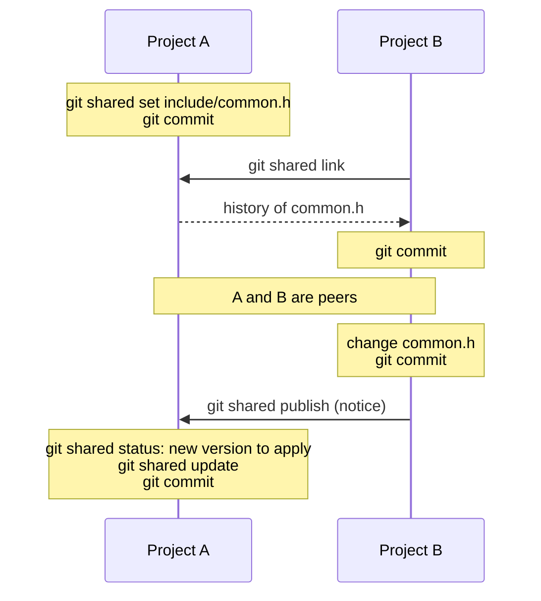
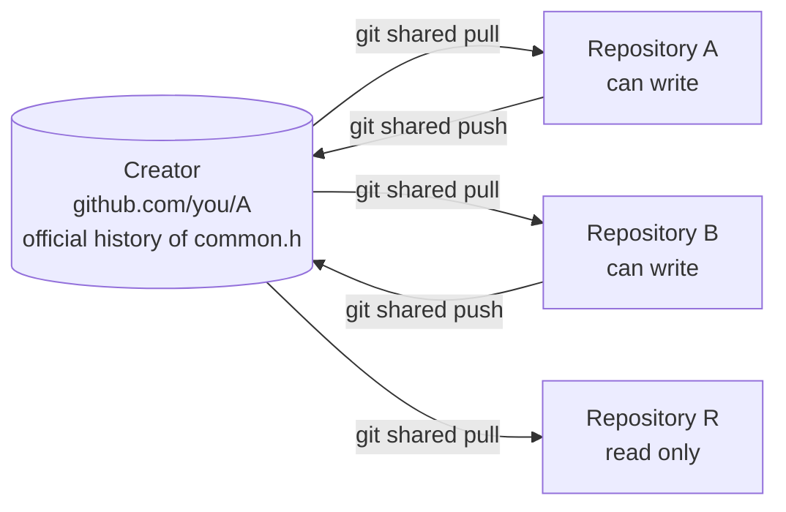
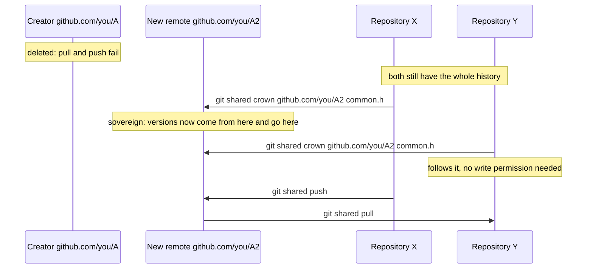

🇮🇹 [Leggi in italiano](README.it.md)
🇬🇧 [Read in English](README.md)

# Shared Files for Git

A **shared file** in several Git™ repositories, always aligned.

A common header, a configuration file, a script: they are often needed by more than one project, and copying them by hand sooner or later leaves you with different copies. `git shared` is a git extension that keeps **the same file aligned across several repositories**. You change the file in any of the projects and publish it; the other projects learn that a new version exists and adopt it when they want, with one command.

The file stays a regular file: anyone using the repository without the extension sees it, builds it and uses it as always.

> **Status:** first release, for repositories on the **same machine**. Support for remote repositories (GitHub, GitLab) is in **beta**: see [Remote repositories](#remote-repositories-beta).

## Installation

**Windows, without compiling.** Download [`dist/windows/git-shared.exe`](dist/windows/git-shared.exe) (built from the latest tag, v0.9.1) and put it in a folder of your `PATH`, for example `%USERPROFILE%\bin`. It needs only git 2.34 or later. Check with `git shared -h`; the manual is in `git shared help`. The file is not signed, so Windows may warn you the first time you run it.

**From the sources.** You need git 2.34 or later, `make` and `gcc` (MinGW-w64 on Windows).

```bash
make            # build
make install    # copy git-shared to ~/bin (Windows: %USERPROFILE%\bin)
git shared -h   # check
make test       # run the test suite (on Windows, from Git Bash)
```

If `git shared` is not found, add that folder to your `PATH`. On Windows, to also get `git shared --help`, run `make install` as administrator.

The tests run several files at a time: by default half of the logical processors of the machine. Set `JOBS` to choose another number, for example `make test JOBS=4`, or `make test JOBS=1` to run them one at a time.

## Two-minute tour

```bash
# Project A: make the header shared
cd ~/projects/A
git shared set include/common.h
git commit -m "common.h becomes shared"

# Project B: link it (the path can be different)
cd ~/projects/B
git shared link ~/projects/A/include/common.h inc/common.h
git commit -m "link common.h"         # from now on A and B know each other

# In B, change the header and publish
git commit -am "add MAX_LEN"
git shared publish                    # A gets a notice

# In A, adopt the new version
cd ~/projects/A
git shared status                     # common.h: new version to apply
git shared update
git commit -m "update common.h"
```



## How it works

- **No main repository.** All the repositories that use the file (the *peers*) are equal, and all of them can change it. There is no server: the repositories talk to each other directly.
- **`.gitshared`.** Lists the shared files of the repository. It is managed by the extension and versioned with the repository, like `.gitmodules`.
- **One history per file.** Each shared file has its own small history of versions, the same in every peer and separate from the project's. It is used to tell which version is newer.
- **Publish, receive, apply.** `publish` creates a version and notifies the peers. Each peer receives it by itself at its next `git shared` command, without touching your files. `update` brings it into the project, and you confirm it with a commit.

## The rules

1. **Only committed work counts.** An uncommitted change is never published. `set`, `link`, `unlink` and `mv` take effect at the commit: until then you can cancel them with `git restore`.
2. **You decide when.** Nothing is published except by `git shared publish`, and the commands never commit by themselves. With `-c` or `-m "message"` they commit right away, but only the shared file and `.gitshared`: the rest of the staging area stays out of the commit.
3. **Your work is never lost.** `update` does not overwrite uncommitted changes, staged ones included. Forcing it takes `-f`.
4. **No change is thrown away.** If two repositories change the file independently, `update` merges the versions like `git merge`. On a conflict, resolve the markers, `git add` and run `git shared update` again, or keep one of the two versions, whole, with `git shared update --ours` or `--theirs`. A binary file is never merged: the file keeps your version and you choose with `--ours` or `--theirs`. To give up, use `git shared update --abort`.
5. **Nothing is locked.** You can change the file even if your copy is behind: the file is *diverged* and `update` merges.

## Commands

| Command | What it does |
|---|---|
| `git shared set <file>` | Makes a file of the repository shared |
| `git shared link <file-in-other-repo> [<dest>]` | Links a file shared by another repository; a copy that already exists is kept and `update` aligns it |
| `git shared unlink <file>` | Stops sharing the file, which stays as a regular file |
| `git shared mv <file> <dest>` | Renames a shared file, only in this repository |
| `git shared status [--peers] [--remote]` | State of each shared file; with `--peers`, also that of the peers; with `--remote`, first asks the creators |
| `git shared publish [<file>]` | Creates a new version and notifies the peers |
| `git shared update [--all] [<file>]` | Receives and applies the latest version; `--ours` / `--theirs` keeps one version, `--abort` gives up a merge |
| `git shared push [<remote>] [<file>]` | Remote (beta): sends the published versions to the creator; the first time, `<remote>` becomes the creator |
| `git shared pull [<file>]` | Remote (beta): receives the versions of the creator, then `update` |
| `git shared crown [<remote>] <file>` | Remote (beta): moves the authority of the file to another remote (default: your own `origin`), the creator stays; `--restore` goes back to the creator, `--accept` / `--reject` decide a change received |
| `git shared branch <file> [-a\|-rm <branch>]` | Chooses the branches where the file is shared; on the others it is a regular file |
| `git shared prune [-n]` | Removes peers that were deleted or no longer share the file |
| `git shared relocate [--copy]` | Tells the peers that the repository was moved or copied |
| `git shared lang [en\|it]` | Language of the manual |

Each command has its own page: `git shared <command> --help`. The same pages are in the [`help/`](help/) folder (Italian in [`help/it/`](help/it/)).

## States

| State | Meaning | What to do |
|---|---|---|
| aligned | You have the latest version | Nothing |
| new version to apply | There is a newer version | `git shared update` |
| applied, to commit | You applied it with `update`, the commit is missing | `git commit` |
| to publish | You have a change the peers don't have | `git shared publish` |
| diverged | You and a peer changed the file separately | `git shared update` |
| merge in progress | `update` found a conflict | Fix it, `git add`, `git shared update`; or `git shared update --ours` / `--theirs` |
| pending commit | `set`, `link`, `unlink` or `mv` not committed yet | `git commit` or `git restore` |
| suspended on this branch | On this branch the file is not shared | Nothing, or `git shared branch` |
| unlinked | The repository declares the file but doesn't know the peers (e.g. a clone) | `git shared link` |
| inconsistent | File renamed without `git shared mv` or deleted, or `.gitshared` edited by hand | `git shared mv`, `git shared unlink` or `git restore .gitshared` |

## Remote repositories (beta)

The main flow works: on GitHub `push`, `pull` and `status --remote` work and are tested; permissions, credentials and the less common cases are not tested yet, and GitLab not at all. It is in the Windows executable of `dist/windows/` (v0.9.1) and in the sources.

Each file gets a **creator**: the remote repository of its first `git shared push`. Its URL is stored in the version history of the file, so whoever has the file knows where new versions come from. Only that history is pushed and fetched, never the project.



As in git, the network is used only when you ask: `publish`, `update` and `status` stay local; `push` sends to the creator, `pull` receives from it and applies, `status --remote` checks for something new.

```bash
# Repository A: its remote becomes the creator of common.h
git shared push origin common.h

# Any other repository: link the file from the creator, by ID
# (the ID is shown by 'git shared status')
git shared link -c https://github.com/you/A 0f8c3e5a9b2d4c71a6e0d9b8c7f61234 inc/common.h

# From then on: publish locally, then push to the creator
# (if you can write there) and a copy to your own remote
git shared publish
git shared push

# Receive and apply the versions of the creator
git shared pull -c
```

Who cannot write to the creator keeps their version as a proposal. Not there yet: linking by name, receiving a proposal with a command, signatures.

The **creator** is the remote repository where it all started, and it never changes. But that repository may get deleted or moved, or you may no longer be able to reach it. Nothing is lost: every repository that uses the file keeps its whole history. You just elect a new point of reference, which here is called a **sovereign**.

Someone who can write to another remote repository, even one created for the purpose, makes it the sovereign with the command `git shared crown <remote> <file>`. The others run the same command with the URL of the sovereign: for them `crown` simply follows it, and no write permission is needed. From then on `push` and `pull` go through the sovereign. If the old remote was only moved and still answers, `crown` tells it too, so whoever follows it finds out.

The switch never happens by itself, because a program cannot tell a remote that is gone from one that is down right now: the user always decides. If the change reaches you from a local peer, `git shared status` points it out, and you accept it with `git shared crown --accept` or refuse it with `--reject`. If the creator becomes reachable again, `git shared crown --restore` gives the authority back to it.



But how does Y learn the new address, if nobody tells it? With the **heirs**. The first two people who push the file to the creator from their own remote, and who can write there, become its heirs (Adam and Eve), and every sovereign gets its own heirs in the same way. Their addresses travel in the version chain, so every repository knows them before they are needed: `git shared status` lists them in order of succession. The two heirs of a sovereign belong to different houses (a house is an owner on a hosting: `github.com/you/A` and `github.com/you/B` are one house, and they usually disappear together).

When the authority stops answering, nobody takes over by itself: `push` tells an heir it can do so with `git shared crown <file>` (without a remote, `crown` means your own `origin`). Once an heir has crowned itself, `git shared pull` on the other repositories tries the heirs in order, finds it and follows it without asking. A sovereign that is not an heir is only pointed out, with the command to follow it. And if the creator comes back, `git shared status --remote` says so: going back to it stays your choice. To keep your remote out of the heirs: `git config shared.heir false`.

## Limits of the first release

- Only single files, text or binary: no folders. A binary file is never merged: on a conflict you keep one of the two versions (`git shared update --ours` or `--theirs`).
- At most 32 peers per file.
- The extension must be installed on every machine that publishes or applies versions. Anyone without it uses the repository as usual.

## FAQ and alternatives

### How do I share a single file between multiple Git repositories?

Make it shared in one repository with `git shared set <file>`, link it from the others with `git shared link`, and from then on use `git shared publish` and `git shared update` to move new versions around. See the [two-minute tour](#two-minute-tour). The path can be different in each repository.

### Why not a git submodule?

A submodule brings in a whole repository, not a single file, and it lives in its own folder at a fixed path. For one header you would need a repository just for that file, and every clone needs `git submodule update`. Changes are made and committed inside the submodule, then recorded again in the parent project. Here the file is a regular file of each project, at the path each project prefers.

### Why not git subtree?

A subtree copies a whole folder into the project and mixes its history with the project's. Sending a change back to the other projects takes `git subtree split` or `git subtree push` by hand, and the other projects must remember to pull it. Here each shared file has its own small history, and the peers are told that a new version exists.

### Why not a symlink?

A symlink points to a path on one machine, so it breaks in a clone or on another computer, and the file it points to is outside the repository. On Windows, Git checks symlinks out as plain text files unless `core.symlinks` is enabled, and creating them needs Developer Mode or administrator rights.

### Why not copy the file by hand, or with a script?

That is exactly how copies drift apart: nobody knows which one is the newest, and a change made in one project is lost when another copy is pasted over it. Here every version is recorded in the file's history, and two independent changes are merged like `git merge`, never overwritten.

### Do the other developers need the extension?

Only those who publish or apply new versions. For everyone else the shared file is a regular file: they clone, build and commit as always.

### Does it work with GitHub or GitLab?

The first release works between repositories on the same machine. Support for remote repositories is in beta: see [Remote repositories](#remote-repositories-beta).

## How it was made

The code was written entirely by an AI model, under human supervision. Ideas, requirements, testing and debugging are driven by a person.

## License and contact

Released under the [MIT](LICENSE) license.

"Shared Files for Git" is an independent project and is not affiliated with or endorsed by the Git project. Git and the Git logo are either registered trademarks or trademarks of Software Freedom Conservancy, Inc., corporate home of the Git project, in the United States and/or other countries.

For questions or reports: lucamurani@gmail.com
